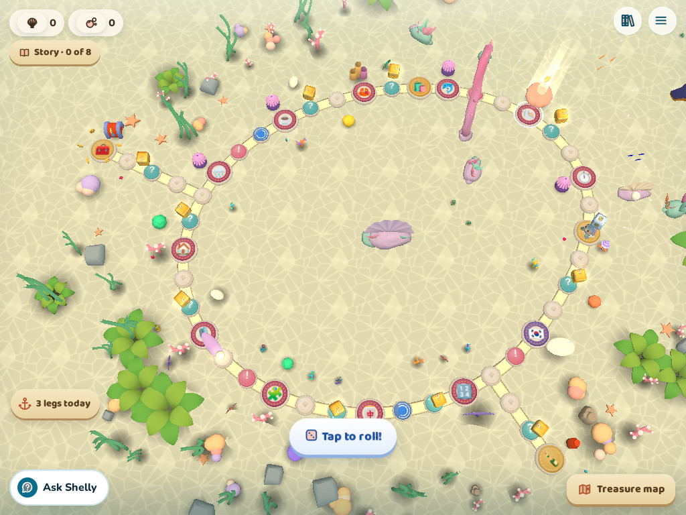
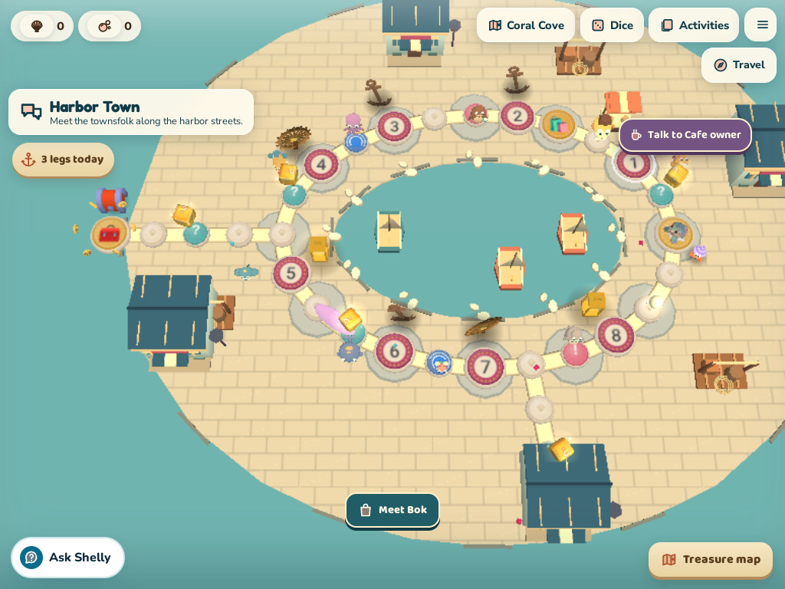
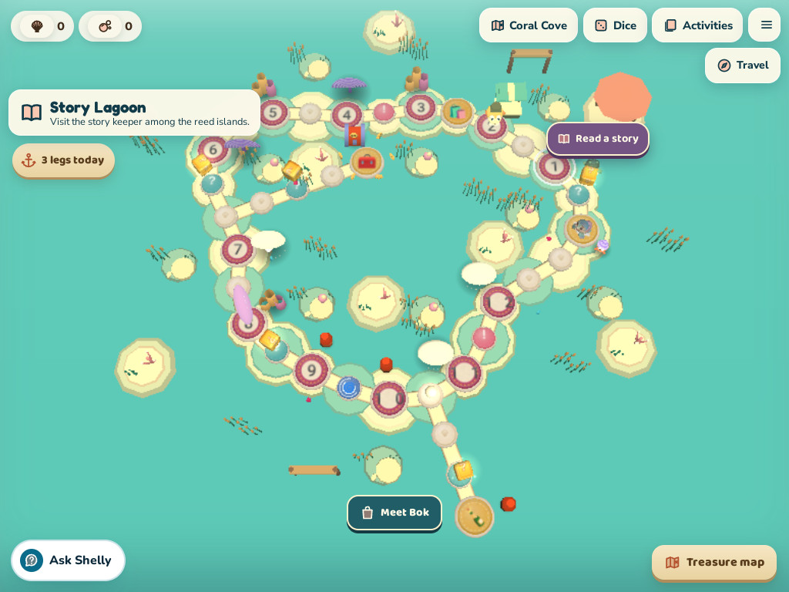
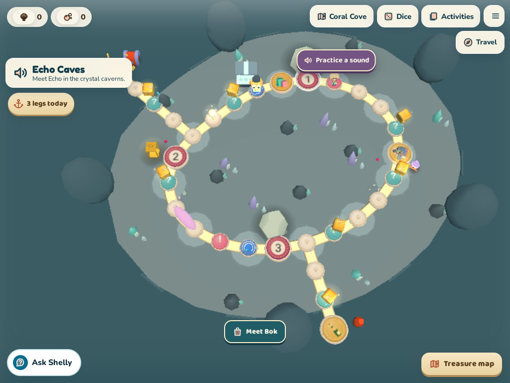
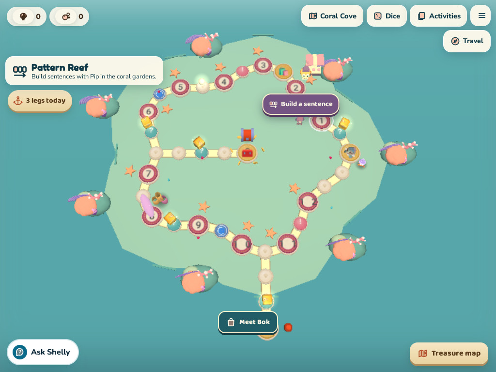
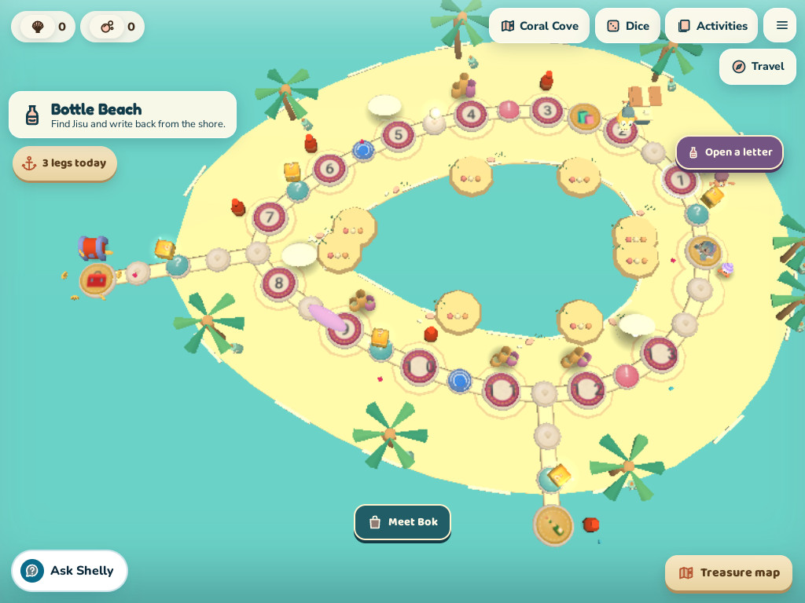
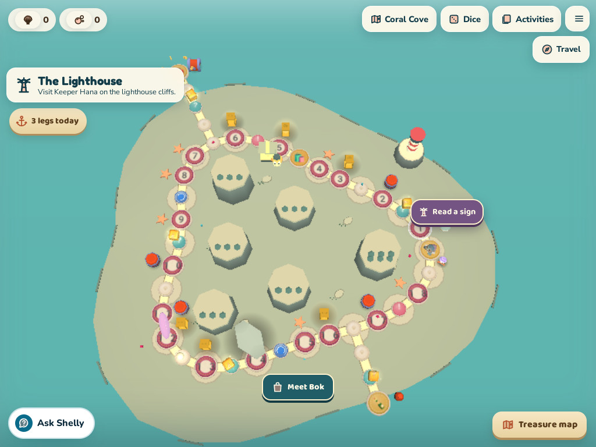
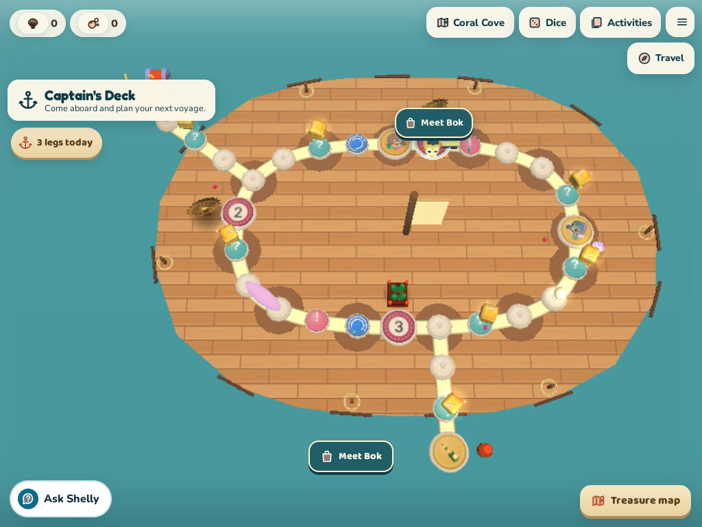

# Earlier playable game captures

Actual November 15 browser captures, before the current world material pass and subsequent cast/palette refinements. The captures used a cloud browser/SwiftShader, not an iPhone XS. They show full routes, real travel tiles, existing character models and UI. They are contextual evidence, not the final visual target or current device performance.

| Region | Complete map | Board camera |
|---|---|---|
| Coral Cove |  | [Normal play view](images/game-nov15/cove-play.jpg) |
| Harbor Town |  | [Normal play view](images/game-nov15/town-play.jpg) |
| Story Lagoon |  | [Normal play view](images/game-nov15/lagoon-play.jpg) |
| Echo Caves |  | [Normal play view](images/game-nov15/caves-play.jpg) |
| Pattern Reef |  | [Normal play view](images/game-nov15/patterns-play.jpg) |
| Bottle Beach |  | [Normal play view](images/game-nov15/beach-play.jpg) |
| The Lighthouse |  | [Normal play view](images/game-nov15/light-play.jpg) |
| Captain’s Deck |  | [Normal play view](images/game-nov15/captain-play.jpg) |

[Travel tile close-up](images/game-nov15/tile-close.jpg) · [Phone framing](images/game-nov15/phone.jpg)
