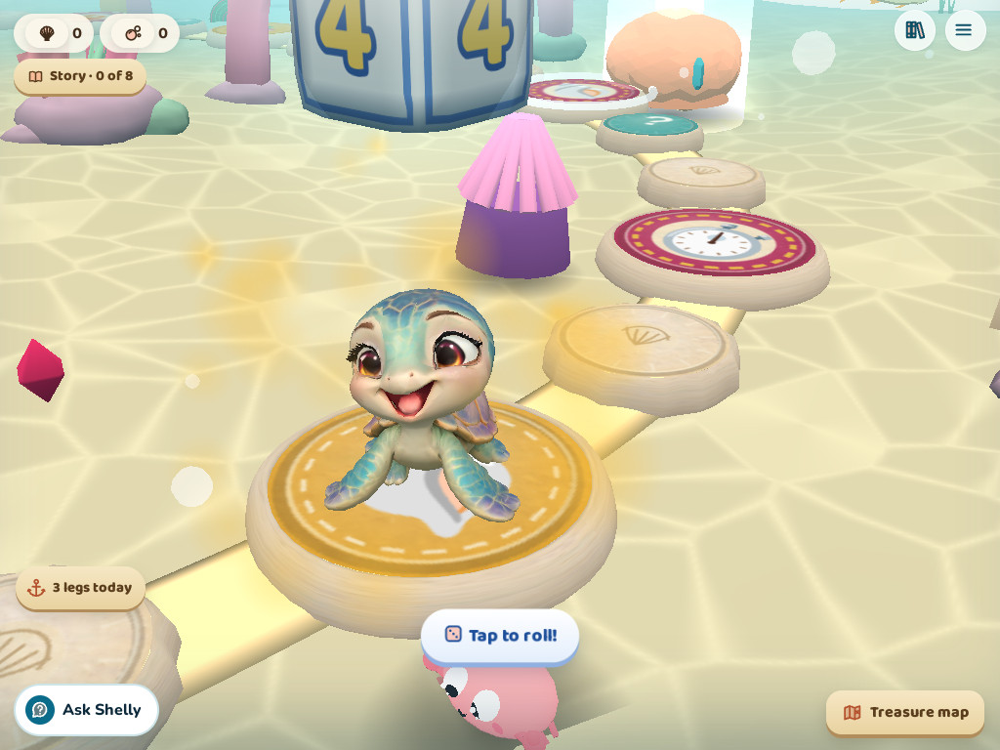
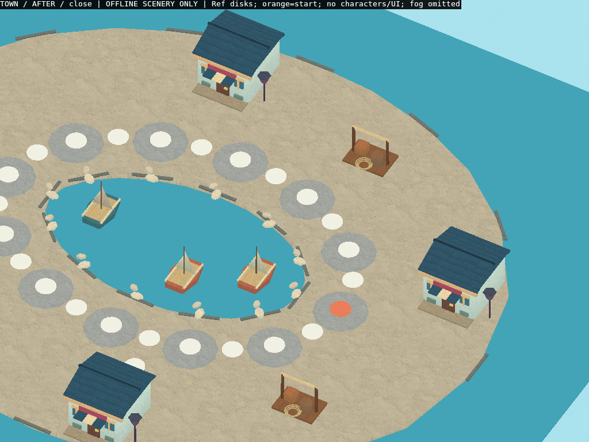
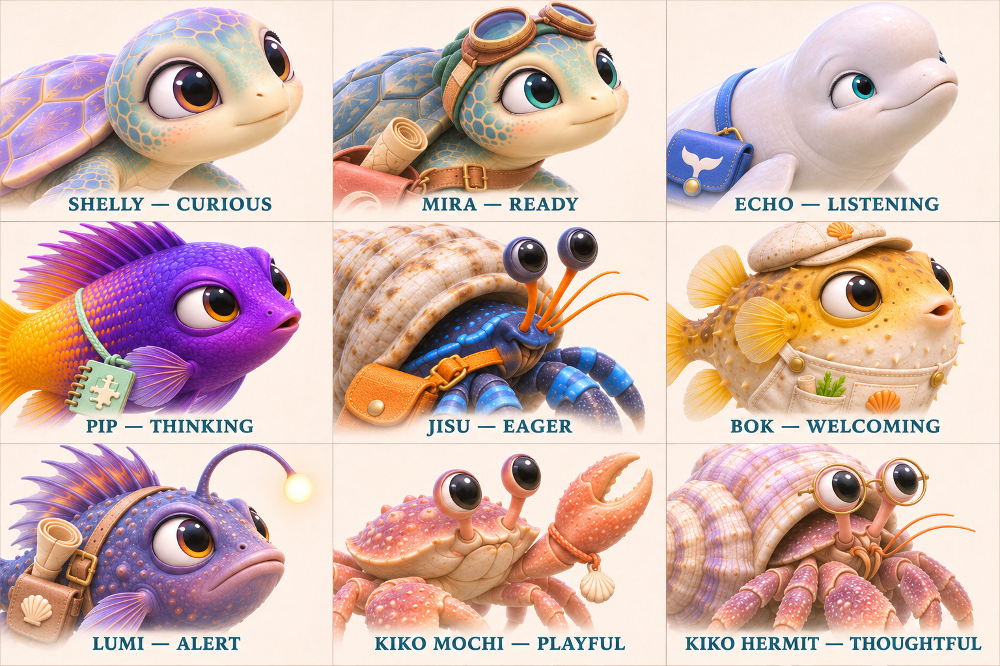
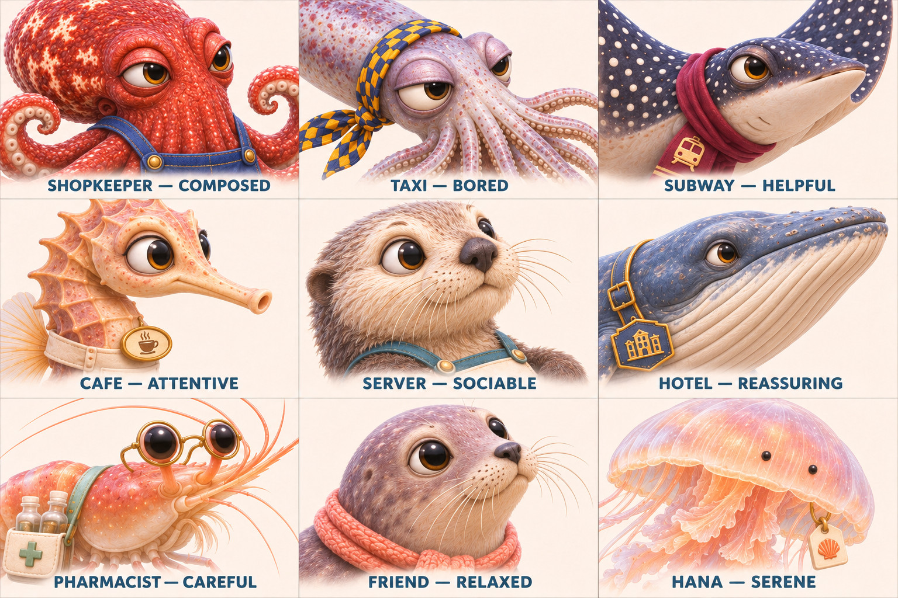
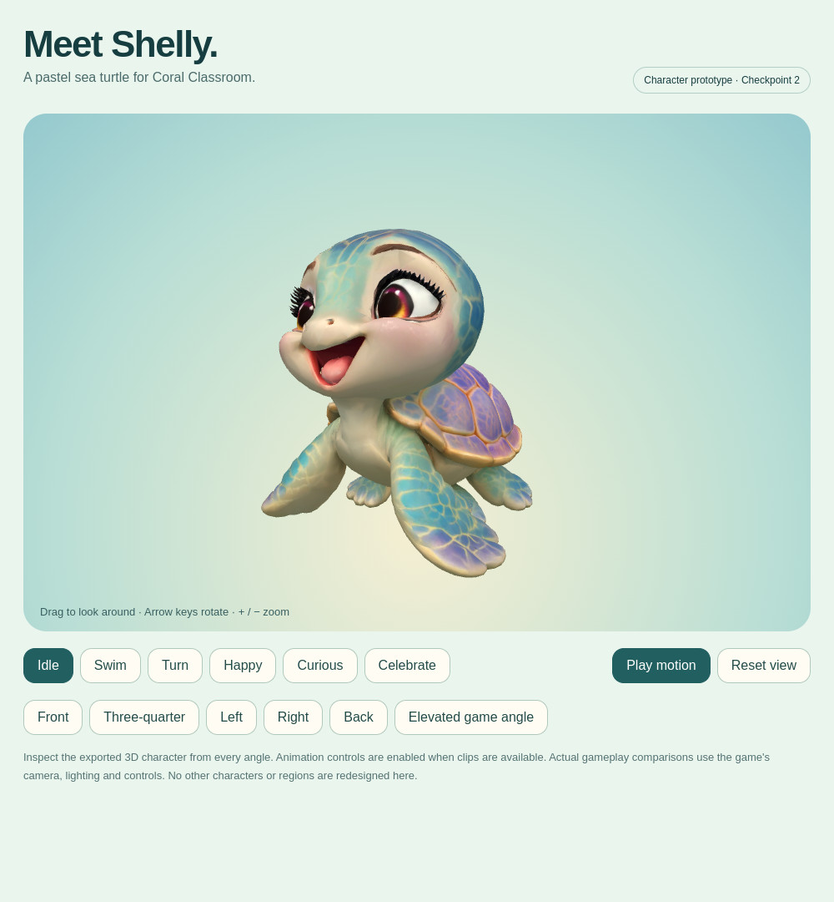

# Coral Classroom — visual review for Fable

Review date: November 16, 2026. This is an art-direction handoff for the owner to share with Fable/Claude: current game evidence, current development sources, and proposed next work.

**Start with [the review prompt](FABLE-PROMPT.md), then [the planned work](PLANNED-WORK.md).** The app files at this branch’s repository root are the older public game. The current visual work is captured inside this review folder; the source snapshot is intentionally separate.

## What the owner wants

A vivid pastel marine world with the appeal of a polished 3D board game and close NPC conversations. The player visits different places and learns Korean by talking with their residents. All characters are marine organisms. Worlds must feel as thoughtfully crafted as Shelly, without expensive rendering. The performance priority is an **iPhone XS**: responsive movement, quick region loads, and smooth dialogue.

Travel tiles get the strongest surface detail. Regions need immediately distinct landmarks and looped routes, clear cameras and uncluttered labels. The owner dislikes plain ellipsoids/boxes with no contours or surface shading, clay-like characters, dull color and human smiles on animals. Character eyes retain the selected A design, with different expressions and timing for each personality.

## Read the evidence correctly

| Evidence | What it shows | What it does not show |
|---|---|---|
| [Earlier game captures](GAME-CAPTURES.md) | Actual complete browser views, November 15 | Current world pass or iPhone frame rate |
| [World comparisons](WORLD-COMPARISONS.md) | Current actual procedural scenery, matched before/after CPU renders | Complete maps, actual tile art, NPCs, UI, fog or device output |
| [Character concept sheets](#character-direction) | Current A-eye/natural-mouth direction and personality references | Finished 3D bodies, facial rigs or runtime animation |
| [Existing model views](#existing-models) | Actual current Shelly/taxi geometry and appearance | The proposed new cast or finished eye acting |
| [Static source audit](evidence/CPU-AUDIT.md) | Exact scenery triangles, batch bins and memory change in a defined scope | Whole-frame draw calls or FPS |

### Complete game context — earlier capture

This is why world polish is needed: the detailed character and route surfaces sit beside simpler props. The mouth shown here predates the owner’s latest natural-mouth direction. See [all eight maps and play cameras](GAME-CAPTURES.md).

### World work in progress — offline subset

One shared eight-panel atlas adds stone, plaster, wood, coral, sand, fabric, roofing and rope. Broad contour changes improve rocks, roofs and sails while most regions use fewer triangles. These textures alone do not finish landmark composition or remove every obvious primitive. The white disks above are reference markers. See [matched before/after views for every region](WORLD-COMPARISONS.md).

## Character direction

These are **generated concept portraits**, accepted as the direction to develop. Each samples one reaction. They are not photos of implemented assets. Body/accessory refinements and an expressive range still need authorship.

[Captain concept](images/concepts/captain.jpg) · [Full cast direction](characters/CAST-DIRECTION.md) · [Per-character eye acting](characters/expression-manifest.json) · [Biological palettes](characters/biological-palettes.json)

Echo is a beluga and Pip a royal gramma. Mira is a teenage coastal turtle, distinct from Shelly. Jisu is a tiny energetic hermit crab with orange mail accessories; the adult octopus is much larger; the ray has the widest wingspan. The taxi squid is bored. The octopus requires exactly eight independent unbranched arms and skin-only camouflage. No universal pearl/glitter treatment or identical smile/eye pose across the cast.

## Existing models

[Shelly front](images/models/shelly-front.jpg) · [Shelly back](images/models/shelly-back.jpg) · [Taxi front](images/models/taxi-front.jpg)

Shelly and the taxi have real textured runtime assets with separate board/close detail levels. Most other residents still use simpler procedural stand-ins. Jisu and octopus reconstructions are unfinished shape-only drafts and remain inactive. Authored personality-specific eye controls and natural mouths for the new cast are planned; static concept portraits must not be mistaken for those features working in-game.

## Technical context and next decisions

The static world pass shares one atlas per live view, multiplies baked vertex shading, and adds no new lights, shadows, normal maps, postprocessing or per-frame surface painting. The touch-tier atlas is 512², about 1.33 MiB with mipmaps. Six scenery sets reduce triangles, Cove is unchanged, and Lighthouse increases modestly. Some batch counts rise; [the audit](evidence/CPU-AUDIT.md) makes that cost visible. Physical iPhone XS testing remains outstanding.

See [source guide](SOURCE-GUIDE.md), [verification](evidence/integration-verification.json), [planned work and open questions](PLANNED-WORK.md), and [Fable’s newly read learning/adaptive-teacher notes](FABLE-NOTES-READ.md). The [manifest](manifest.json) records image roles and SHA-256 provenance.
